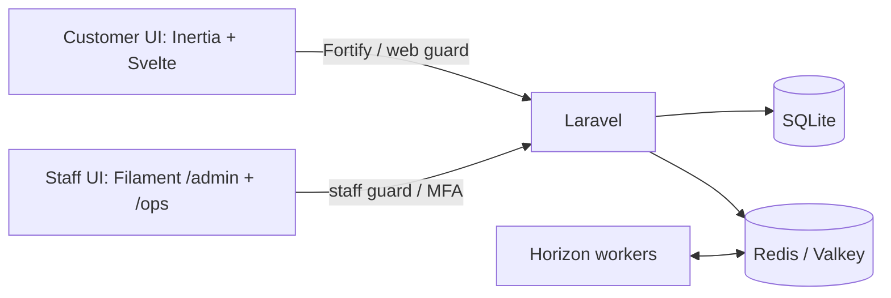

# Ajo

Ajo is a portfolio project for a fictional NGN savings platform, focused on financial correctness, reliable interest accrual, and accountable operations.

**Planned core:** a double-entry wallet, Paystack test-mode payments, fixed-term savings, compounding, early-exit penalties, rollover, staff approvals, and a tamper-evident audit trail.

**Stack:** PHP 8.5, Laravel 13, Inertia 3, Svelte 5, Filament 5, SQLite, and Redis/Horizon.

**Implemented:** customer authentication, isolated staff panels with mandatory MFA, role permissions, injectable clocks, branded interfaces, and Redis/Horizon infrastructure. Financial features remain planned.

## Directory structure

```text
app/
  Actions/Fortify/     Customer authentication actions
  Console/Commands/   Initial admin bootstrap
  Contracts/          Clock interface
  Filament/           Staff management resources
  Http/               Controllers, requests, middleware
  Models/, Policies/  Customer/staff identities and authorization
  Providers/          Application, authentication, panels, Horizon
  Support/            Clock implementations and staff MFA adapter
config/               Authentication, permissions, cache, queues
database/             Migrations, factories, role seeders
resources/js/         Svelte pages, layouts, shared components
resources/css/        Customer theme
routes/               Customer routes and scheduled commands
tests/                Pest feature and unit tests
.github/workflows/    CI with Redis integration coverage
```

## Architecture

One Laravel application serves two interfaces with separate authentication populations. Customers use Fortify and the `web` guard; both staff panels share the `staff` guard. Managers access `/ops`; admins access `/admin` and `/ops`. Staff management actions also require explicit permissions.



SQLite stores application data. Redis provides caching, locks, and queues through Predis; local development uses native Valkey, while CI uses Redis. Horizon reserves separate capacity for `default`, `webhooks`, `accrual`, and `payouts`; financial jobs will arrive with their respective features.
