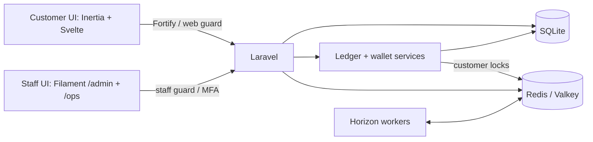

# Ajo

Ajo is a portfolio project for a fictional NGN savings platform, focused on financial correctness, reliable interest accrual, and accountable operations.

**Planned next:** Paystack test-mode payments, fixed-term savings, compounding, early-exit penalties, rollover, staff approvals, and a tamper-evident audit trail.

**Stack:** PHP 8.5, Laravel 13, Inertia 3, Svelte 5, Filament 5, SQLite, and Redis/Horizon.

**Implemented:** customer authentication, isolated staff panels with mandatory MFA, role permissions, injectable clocks, branded interfaces, Redis/Horizon infrastructure, exact NGN money values, an immutable double-entry ledger, and customer wallets with balances and transaction history.

## Directory structure

```text
app/
  Actions/Fortify/     Customer authentication actions
  Console/Commands/   Admin bootstrap, wallet provisioning, ledger projections
  Contracts/          Clock interface
  Filament/           Staff management resources
  Http/               Controllers, requests, middleware
  Models/, Policies/  Identities, authorization, ledger accounts and history
  Providers/          Application, authentication, panels, Horizon
  Support/            Clocks, staff MFA, money, ledger and wallet services
config/               Authentication, permissions, cache, queues, ledger locks
database/             Migrations, factories, role seeders
resources/js/         Svelte pages, layouts, shared components
resources/css/        Customer theme
routes/               Customer routes and scheduled commands
tests/                Pest feature and unit tests
.github/workflows/    CI with Redis integration coverage
```

## Architecture

One Laravel application serves two interfaces with separate authentication populations. Customers use Fortify and the `web` guard; both staff panels share the `staff` guard. Managers access `/ops`; admins access `/admin` and `/ops`. Staff management actions also require explicit permissions.



SQLite stores application data, including ledger accounts, journals, and entries. Redis provides caching, locks, and queues through Predis; local development uses native Valkey, while CI uses Redis. Financial writes use customer locks and SQLite `IMMEDIATE` transactions with bounded retries for database contention. Redis/Valkey is required for wallet provisioning during registration. Horizon reserves separate capacity for `default`, `webhooks`, `accrual`, and `payouts`; financial jobs will arrive with their respective features.

## Money, ledger, and wallets

- Money uses integer kobo with exact decimal-string JSON serialization. Basis-point calculations use exact arithmetic and half-even rounding to whole kobo.
- Journals require balanced, nonzero entries. Operation keys make identical requests idempotent and reject reuse with different inputs. Posted journals and entries are immutable, with database triggers guarding against updates, deletes, and replacement collisions.
- Corrections use linked reversing journals, preserving the original history. Economic effective dates are stored separately from UTC posting timestamps.
- Account balances are rebuildable projections. Posting validates balances against ledger entries and prevents wallet overspending; spending requires an active customer with a verified email.
- Registration atomically creates the customer and an empty wallet without opening journals. The wallet page shows the authenticated customer's NGN balance and paginated history, including effective dates and posting timestamps.
- Closing an unused account permanently deletes it and its empty ledger accounts. Customers with financial history are deactivated, retaining their identity and financial records even when their balance is zero.

Payment integrations and customer deposit, withdrawal, and savings flows remain planned.

## Ledger maintenance

Run these commands against a migrated database with Redis/Valkey available:

| Command                                    | Purpose                                                                                          |
| ------------------------------------------ | ------------------------------------------------------------------------------------------------ |
| `php artisan wallets:provision`            | Idempotently create empty wallets for existing customers without inventing opening balances.     |
| `php artisan ledger:projections`           | Compare stored balance projections with ledger entries; exit unsuccessfully if mismatches exist. |
| `php artisan ledger:projections --rebuild` | Rebuild stored balances from ledger entries, then verify them.                                   |

## Verification

Pest covers exact money values and rounding, immutable and idempotent posting, reversals, projection recovery, wallet access, registration rollback, and account closure:

```sh
php artisan test --compact tests/Unit/MoneyTest.php tests/Feature/LedgerTest.php tests/Feature/WalletTest.php
```

Concurrency tests use independent workers, a temporary SQLite database, and a running Redis/Valkey service. They exercise overspending, operation replay, account closure races, expired locks, and database contention:

```sh
RUN_REDIS_TESTS=1 php artisan test --compact tests/Feature/LedgerConcurrencyTest.php
```

Run the full suite with `php artisan test --compact`. CI enables Redis integration coverage through `RUN_REDIS_TESTS=1`.
