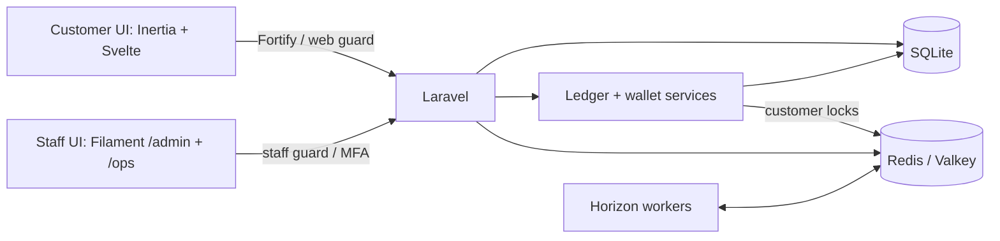

# Ajo

Ajo is a portfolio project for a fictional NGN savings platform, focused on financial correctness, reliable interest accrual, and accountable operations.

**Delivery scope:** The financial capabilities listed below are implemented in code. Real Paystack test-mode acceptance and deployment verification remain separate checks; production payments and later delivery slices remain outside scope.

**Stack:** PHP 8.5, Laravel 13, Inertia 3, Svelte 5, Filament 5, SQLite, and Redis/Horizon.

**Implemented:** customer authentication, isolated staff panels with mandatory MFA, role permissions, injectable clocks, branded interfaces, Redis/Horizon infrastructure, exact NGN money values, an immutable double-entry ledger, customer wallets with balances and transaction history, test-mode deposits and withdrawals, recovery and staff approvals, a tamper-evident audit trail, and fixed-term savings with compounding, early closure, waivers, and rollover.

## Directory structure

```text
.
├── app/
│   ├── Actions/Fortify/       Customer registration and password reset
│   ├── Concerns/             Shared profile and password validation rules
│   ├── Console/Commands/     Staff bootstrap, recovery, backfills, ledger/audit checks
│   ├── Contracts/            Clock and payment gateway interfaces
│   ├── Filament/
│   │   ├── Resources/        Admin: staff, products, audit, exceptions, simulations
│   │   └── Ops/Resources/    Operations: customers, withdrawals, approvals, plans
│   ├── Http/
│   │   ├── Controllers/      Customer actions, provider callbacks, settings
│   │   ├── Requests/         Request authorization, validation, amount conversion
│   │   └── Middleware/       Shared Inertia props and appearance preferences
│   ├── Jobs/                 Verification, payouts, accrual, notice delivery
│   ├── Models/               Identities, financial records, inbox and delivery state
│   ├── Notifications/        Payment, withdrawal, and savings email content
│   ├── Policies/             Staff, product, and payment-exception authorization
│   ├── Providers/            Service bindings, authentication, panels, Horizon
│   └── Support/
│       ├── DepositStates/    Deposit lifecycle transitions
│       ├── PlanStates/       Savings lifecycle transitions
│       ├── WithdrawalStates/ Withdrawal lifecycle transitions
│       └── *.php             Money, ledger, payments, savings, approvals, audit
├── bootstrap/                Application routing and middleware setup
├── config/                   Framework settings and financial processing limits
├── database/
│   ├── factories/            Model fixtures for tests and development
│   ├── migrations/           Tables, indexes, and financial evidence guards
│   └── seeders/              Development data and staff permission roles
├── docs/definitions.md       Financial and operational terminology
├── resources/
│   ├── css/                  Customer theme
│   ├── js/
│   │   ├── pages/            Customer financial, authentication, and settings screens
│   │   ├── layouts/          Application, authentication, and settings shells
│   │   ├── components/       Shared interface and security controls; UI primitives
│   │   ├── lib/              Money/rate formatting, theme, navigation, MFA state
│   │   ├── types/            Shared page and financial data types
│   │   └── actions/, routes/, wayfinder/  Generated typed route helpers
│   └── views/                Initial Inertia HTML document
├── routes/
│   ├── web.php               Customer pages, financial actions, provider callbacks
│   ├── settings.php          Profile, security, and appearance routes
│   └── console.php           Scheduled payment, payout, and savings recovery
├── tests/
│   ├── Feature/              Financial lifecycles, authentication, staff, infrastructure
│   ├── Unit/                 Money and rate arithmetic
│   └── Pest.php              Shared test setup and financial fixtures
└── .github/workflows/        CI checks with Redis integration coverage
```

## Architecture

One Laravel application serves two interfaces with separate authentication populations. Customers use Fortify and the `web` guard; both staff panels share the `staff` guard. Managers access `/ops`; admins access `/admin` and `/ops`. Staff management actions also require explicit permissions.



SQLite stores application data, including ledger accounts, journals, and entries. Redis provides caching, locks, and queues through Predis; local development uses native Valkey, while CI uses Redis. Financial writes use customer locks and SQLite `IMMEDIATE` transactions with bounded retries for database contention. Redis/Valkey is required for wallet provisioning during registration. Horizon reserves separate capacity for `default`, `webhooks`, `accrual`, and `payouts`; payment, savings, and payout jobs use these queues with durable recovery records.

## Key processes and connections

Controllers handle HTTP access and responses. Form requests validate customer input; services in `app/Support` enforce financial rules. Filament staff actions call these services too, so customer pages, jobs, and staff panels share the same posting rules.

- **Registration and wallets:** `CreateNewUser` creates a `User` and calls `Wallets::provision` in one transaction. Each customer gets a wallet liability account and a recovery receivable account. `WalletController` reads ledger history and reverses liability signs for customer display.
- **Deposits:** `DepositController` calls `Deposits` to save a `Deposit` before opening checkout. Browser returns request verification; authenticated webhooks enter `PaymentInbox` as `WebhookEvent` records. Workers fetch provider evidence before `Deposits` posts value through `Ledger`. Processing a receipt does not mean the payment has reached a final outcome.
- **Withdrawals and approvals:** `SavedDestinationController` uses `Destinations` to verify and save bank details. `WithdrawalController` calls `Withdrawals` to reserve principal and fees in a `WithdrawalRequest`. Reservations above the saved review threshold require a distinct requester and checker through `Approvals` and `ApprovalRequest`; reservations at or below that threshold use direct staff review. Dispatch commits submission intent before the provider call; the provider approval callback checks that reservation, and verification jobs reconcile the final outcome and actual fee.
- **Savings:** `SavingsPlanController` uses `SavingsPlans` to create, accept, and fund a `SavingsPlan` with a copy of its `SavingsProductVersion` terms. `SavingsProcessing` queues work; `SavingsAccrual` records completed days and compounding evidence in bounded batches. `SavingsSettlements` checks that evidence before settlement at maturity or early closure, applies deductions and approved waivers, and can fund one renewal child at maturity when the customer has consented and remains eligible.
- **Recovery and notices:** `DepositRecovery` verifies refund deductions; `RecoveryControls` directs incoming value to recovery debt before wallet credit. Outstanding debt blocks new spending flows such as payouts and savings funding. Payment and savings notice intent is saved with the financial transaction; workers deliver it separately, while scheduled commands rediscover due work after queue failures.
- **Audit:** `AuditTrail` redacts recognized sensitive fields and appends signed `AuditEvent` records in a hash chain. `SecurityAudit` adds authentication and staff-access events. `AuditArchives` verifies and archives old prefixes during maintenance, then removes expired files while retaining signed boundary records.

Key stored links:

| Records | Connection |
| --- | --- |
| `User` → `Deposit`, `WithdrawalRequest`, `SavingsPlan`, `LedgerAccount` | `user_id` identifies the customer whose value or contract is recorded. |
| `WithdrawalRequest` → `SavedDestination` | `saved_destination_id` links the saved account; the request also keeps its own destination and fee snapshot. |
| `SavingsProduct` → `SavingsProductVersion` → `SavingsPlan` | Versioned terms and the plan's contract copy preserve the agreement when products change. |
| `Journal` → `LedgerEntry` → `LedgerAccount` | Entries link each posting to its journal and account; financial records retain journal IDs as evidence. |
| `ApprovalRequest` → action subject and `Staff` | `subject_type`/`subject_id` identify the target; `requested_by` and `decided_by` identify the separate staff actors. |

## Money, ledger, and wallets

- Money uses integer kobo with exact decimal-string JSON serialization. Basis-point calculations use exact arithmetic and half-even rounding to whole kobo.
- Journals require balanced, nonzero entries. Operation keys make identical requests idempotent and reject reuse with different inputs. Posted journals and entries are immutable, with database triggers guarding against updates, deletes, and replacement collisions.
- Corrections use linked reversing journals, preserving the original history. Economic effective dates are stored separately from UTC posting timestamps.
- Account balances are rebuildable projections. Posting validates balances against ledger entries and prevents wallet overspending; spending requires an active customer with a verified email.
- Registration atomically creates the customer and an empty wallet without opening journals. The wallet page shows the authenticated customer's NGN balance and paginated history, including effective dates and posting timestamps.
- Account closure records an audit event and deactivates the customer, retaining financial and audit references.

Deposits and withdrawals verify provider evidence server-side before recognizing financial effects. Savings support simple, daily, and 30-day compounding, customer early termination, approved waivers and administrative closure, and maturity rollover. See [definitions](docs/definitions.md) for terminology.

## Setup

`composer setup` installs dependencies, prepares `.env`, generates the application key, creates the default SQLite file if missing, runs migrations, and builds frontend assets. The file-creation step does not truncate an existing database file. Redis/Valkey and appropriate test-mode credentials are required for the corresponding runtime flows. A custom SQLite path must exist before commands open its connection.

Older development plans created before calculation preparation was introduced may lack a calculation record and remain blocked from UI funding. Current plan creation and renewals prepare that record in the same transaction; future imports must use the same service or preserve that invariant.

## Ledger maintenance

Run these commands against a migrated database with Redis/Valkey available:

| Command                                    | Purpose                                                                                          |
| ------------------------------------------ | ------------------------------------------------------------------------------------------------ |
| `php artisan wallets:provision`            | Idempotently create empty wallets for existing customers without inventing opening balances.     |
| `php artisan ledger:projections`           | Compare stored balance projections with ledger entries; exit unsuccessfully if mismatches exist. |
| `php artisan ledger:projections --rebuild` | Rebuild stored balances from ledger entries, then verify them.                                   |

## Verification

Feature tests are grouped under `Audit`, `Auth`, `Infrastructure`, `Integration`, `Ledger`, `Payments`, `Savings`, `Settings`, `Staff`, and `Withdrawals`. Dashboard and example tests remain at the feature root; arithmetic tests remain under `tests/Unit`. Coverage includes financial lifecycles, staff actions, recovery, and seeded sequences across features.

For the ledger and wallet subset:

```sh
php artisan test --compact tests/Unit/MoneyTest.php tests/Feature/Ledger/LedgerTest.php tests/Feature/Ledger/WalletTest.php
```

Concurrency tests use independent workers, a temporary SQLite database, and a running Redis/Valkey service. They exercise overspending, operation replay, account closure races, expired locks, and database contention:

```sh
RUN_REDIS_TESTS=1 php artisan test --compact tests/Feature/Ledger/LedgerConcurrencyTest.php
```

Run the full suite with `php artisan test --compact`. CI enables Redis integration coverage through `RUN_REDIS_TESTS=1`.
