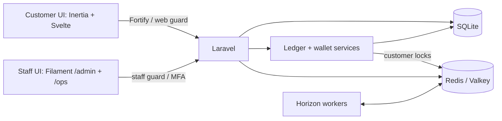

# Application architecture

[Back to the project overview](../README.md)

The financial capabilities listed below are implemented in code. Real Paystack test-mode acceptance and deployment verification remain separate checks; production payments and later delivery slices remain outside scope.

Implemented capabilities include customer authentication, isolated staff panels with mandatory MFA, role permissions, injectable clocks, branded interfaces, Redis/Horizon infrastructure, exact NGN money values, an immutable double-entry ledger, customer wallets with balances and transaction history, test-mode deposits and withdrawals, recovery and staff approvals, a tamper-evident audit trail, fixed-term savings with compounding, early closure, waivers, and rollover, and a demo time machine with seeded financial history.

## Directory structure

```text
.
├── app/
│   ├── Actions/Fortify/       Customer registration and password reset
│   ├── Concerns/             Shared profile and password validation rules
│   ├── Console/Commands/     Staff bootstrap, recovery, backfills, ledger/audit checks
│   ├── Contracts/            Clock and payment gateway interfaces
│   ├── Filament/
│   │   ├── Pages/            Admin Time Machine for shared demo advancement
│   │   ├── Resources/        Admin: staff, products, audit, exceptions, simulations
│   │   └── Ops/Resources/    Operations: customers, withdrawals, approvals, plans
│   ├── Http/
│   │   ├── Controllers/      Customer actions, provider callbacks, settings
│   │   ├── Requests/         Request authorization, validation, amount conversion
│   │   └── Middleware/       Shared Inertia props and appearance preferences
│   ├── Jobs/                 Verification, payouts, accrual, notice delivery
│   ├── Models/               Identities, financial records, inbox and delivery state
│   ├── Notifications/        Payment, withdrawal, and savings email content
│   ├── Policies/             Staff, product, and payment-exception authorization
│   ├── Providers/            Service bindings, authentication, panels, Horizon
│   └── Support/
│       ├── Audit/            Signed events, security audit, archives, cleanup guards
│       ├── Auth/             Financial approvals and staff MFA audit integration
│       ├── Clock/            System, persisted demo, and controllable test clocks
│       ├── Demo/             Chronological processing and fictional history
│       ├── Ledger/           Posting, wallet accounts, locks, and recovery controls
│       ├── Money/            Integer money, decimal-naira conversion, rates, casts
│       ├── Payments/         Gateways, deposits, inbox, scans, notices, simulations
│       │   └── DepositStates/    Deposit lifecycle transitions
│       ├── Savings/          Products, contracts, accrual, settlement, and notices
│       │   └── PlanStates/       Savings lifecycle transitions
│       └── Withdrawals/      Verified destinations, reservations, and payout outcomes
│           └── WithdrawalStates/ Withdrawal lifecycle transitions
├── bootstrap/                Application routing and middleware setup
├── config/                   Framework settings and financial processing limits
├── database/
│   ├── factories/            Model fixtures for tests and development
│   ├── migrations/           Tables, indexes, and financial evidence guards
│   └── seeders/              Development data and staff permission roles
├── docs/
│   ├── architecture.md       Structure, services, financial flows, and stored links
│   ├── operations.md         Setup details, demo mode, maintenance, and verification
│   └── definitions.md        Financial and operational terminology
├── resources/
│   ├── css/                  Customer theme
│   ├── js/
│   │   ├── pages/            Customer financial, authentication, and settings screens
│   │   ├── layouts/          Application, authentication, and settings shells
│   │   ├── components/       Shared interface and security controls; UI primitives
│   │   ├── lib/              Money/rate formatting, theme, navigation, MFA state
│   │   ├── types/            Shared page and financial data types
│   │   └── actions/, routes/, wayfinder/  Generated typed route helpers
│   └── views/                Initial Inertia HTML document
├── routes/
│   ├── web.php               Customer pages, financial actions, provider callbacks
│   ├── settings.php          Profile, security, and appearance routes
│   └── console.php           Scheduled payment, payout, and savings recovery
├── tests/
│   ├── Feature/              Financial lifecycles, authentication, staff, infrastructure
│   ├── Unit/                 Money and rate arithmetic
│   └── Pest.php              Shared test setup and financial fixtures
└── .github/workflows/        CI checks with Redis integration coverage
```

## Architecture

One Laravel application serves two interfaces with separate authentication populations. Customers use Fortify and the `web` guard; both staff panels share the `staff` guard. Managers access `/ops`; admins access `/admin` and `/ops`. Staff management actions also require explicit permissions.



SQLite stores application data, including ledger accounts, journals, and entries. Redis provides caching, locks, and queues through Predis; local development uses native Valkey, while CI uses Redis. Financial writes use customer locks and SQLite `IMMEDIATE` transactions with bounded retries for database contention. Redis/Valkey is required for wallet provisioning during registration. Horizon reserves separate capacity for `default`, `webhooks`, `accrual`, and `payouts`; payment, savings, and payout jobs use these queues with durable recovery records.

## Key processes and connections

Controllers handle HTTP access and responses. Form requests validate customer input; services in `app/Support` enforce financial rules. Filament staff actions call these services too, so customer pages, jobs, and staff panels share the same posting rules.

Support classes are grouped by responsibility. A service imports shared code from another group instead of keeping a second implementation. Each state family stays beside its base state class so state discovery can resolve the existing persisted aliases. Moving a class does not change those aliases.

- **Registration and wallets:** `CreateNewUser` creates a `User` and calls `Wallets::provision` in one transaction. Each customer gets a wallet liability account and a recovery receivable account. `WalletController` reads ledger history and reverses liability signs for customer display.
- **Deposits:** `DepositController` calls `Deposits` to save a `Deposit` before opening checkout. Browser returns request verification; authenticated webhooks enter `PaymentInbox` as `WebhookEvent` records. Workers fetch provider evidence before `Deposits` posts value through `Ledger`. Processing a receipt does not mean the payment has reached a final outcome.
- **Withdrawals and approvals:** `SavedDestinationController` uses `Destinations` to verify and save bank details. `WithdrawalController` calls `Withdrawals` to reserve principal and fees in a `WithdrawalRequest`. Reservations above the saved review threshold require a distinct requester and checker through `Approvals` and `ApprovalRequest`; reservations at or below that threshold use direct staff review. Dispatch commits submission intent before the provider call; the provider approval callback checks that reservation, and verification jobs reconcile the final outcome and actual fee.
- **Savings:** `SavingsPlanController` uses `SavingsPlans` to create, accept, and fund a `SavingsPlan` with a copy of its `SavingsProductVersion` terms. `SavingsProcessing` queues work; `SavingsAccrual` records completed days and compounding evidence in bounded batches. `SavingsSettlements` checks that evidence before settlement at maturity or early closure, applies deductions and approved waivers, and can fund one renewal child at maturity when the customer has consented and remains eligible.
- **Recovery and notices:** `DepositRecovery` verifies refund deductions; `RecoveryControls` directs incoming value to recovery debt before wallet credit. Outstanding debt blocks new spending flows such as payouts and savings funding. Payment and savings notice intent is saved with the financial transaction; workers deliver it separately, while scheduled commands rediscover due work after queue failures.
- **Audit:** `AuditTrail` redacts recognized sensitive fields and appends signed `AuditEvent` records in a hash chain. `SecurityAudit` adds authentication and staff-access events. `AuditArchives` verifies and archives old prefixes during maintenance, then removes expired files while retaining signed boundary records.
- **Demo time:** With `APP_ENV=demo`, `DemoClock` reads a shared persisted instant. `DemoTimeMachine` processes due financial work before advancing to the next scheduled instant. `DemoHistory` uses the ordinary payment, savings, and settlement services to build fictional history with resumable checkpoints.

Key stored links:

| Records                                                                 | Connection                                                                                                           |
| ----------------------------------------------------------------------- | -------------------------------------------------------------------------------------------------------------------- |
| `User` → `Deposit`, `WithdrawalRequest`, `SavingsPlan`, `LedgerAccount` | `user_id` identifies the customer whose value or contract is recorded.                                               |
| `WithdrawalRequest` → `SavedDestination`                                | `saved_destination_id` links the saved account; the request also keeps its own destination and fee snapshot.         |
| `SavingsProduct` → `SavingsProductVersion` → `SavingsPlan`              | Versioned terms and the plan's contract copy preserve the agreement when products change.                            |
| `Journal` → `LedgerEntry` → `LedgerAccount`                             | Entries link each posting to its journal and account; financial records retain journal IDs as evidence.              |
| `ApprovalRequest` → action subject and `Staff`                          | `subject_type`/`subject_id` identify the target; `requested_by` and `decided_by` identify the separate staff actors. |

## Money, ledger, and wallets

- Money uses integer kobo with exact decimal-string JSON serialization. `Money::fromNaira()` parses nonnegative decimal naira for deposit, withdrawal, and savings requests; each request retains its own validation and limits. `Money::toNaira()` formats exact two-decimal amounts for financial emails without floats. Basis-point calculations use exact arithmetic and half-even rounding to whole kobo.
- Journals require balanced, nonzero entries. Operation keys make identical requests idempotent and reject reuse with different inputs. Posted journals and entries are immutable, with database triggers guarding against updates, deletes, and replacement collisions.
- Corrections use linked reversing journals, preserving the original history. Economic effective dates are stored separately from UTC posting timestamps.
- Account balances are rebuildable projections. Posting validates balances against ledger entries and prevents wallet overspending; spending requires an active customer with a verified email.
- Registration atomically creates the customer and an empty wallet without opening journals. The wallet page shows the authenticated customer's NGN balance and paginated history, including effective dates and posting timestamps.
- Account closure records an audit event and deactivates the customer, retaining financial and audit references.

Deposits and withdrawals verify provider evidence server-side before recognizing financial effects. Savings support simple, daily, and 30-day compounding, customer early termination, approved waivers and administrative closure, and maturity rollover. See [definitions](definitions.md) for terminology.
